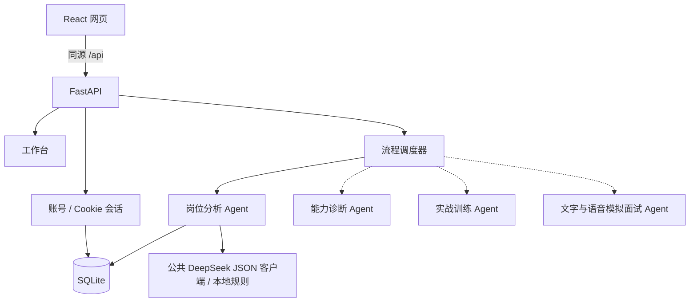

# 架构与边界

实线表示已实现，虚线表示尚待组员接入。

## 公共基础

- `create_app(settings)` 支持独立测试实例，配置使用 `OFFER_` 环境变量。
- SQLite 使用外键、WAL、参数绑定与编号迁移，每次操作独立连接。
- 注册使用 Argon2id 哈希；数据库只保存随机会话令牌的 SHA-256 摘要。
- HttpOnly、SameSite=Lax Cookie，服务端固定到期、登录轮换、退出立即撤销。
- 所有认证响应禁止缓存；校验 Origin，退出另需会话 CSRF token。
- `/auth/me` 恢复当前用户和 CSRF token；前端只在内存中保留这些数据。
- 注册与登录共享每 IP 每分钟 10 次进程内限流，单进程开发版。
- 生产配置强制 Secure Cookie 和 HTTPS 来源。当前不信任 X-Forwarded-For。

## 后续扩展

每个 Agent 拥有独立任务说明、工具权限和结构化输出，共享用户能力档案与证据引用。
调度器负责调用顺序、状态持久化、超时、预算、有限重试，先采用明确工作流。
工具结果必须可核验；模型判断不代表真实录用概率。
用户档案与任务记录按登录身份隔离；新增接口需同时提交越权测试。

岗位分析现已接入。结果按用户保存在 job_analysis_tasks；迁移 v2 追加表，不修改 v1。
规则和 DeepSeek 都输出统一要求结构，引用逐字核验并定位；固定工作流处理
材料接收、提取、证据核对及状态保存。后续三个 Agent 暂记 skipped。
当前单进程开发部署在启动时将残留 running 任务标记为中断失败，不自动重放付费请求。
多进程/多实例部署前需将任务归属、并发控制、恢复机制和限流迁移到共享任务队列。

成员 D 的面试模块规划同时支持文字和语音。语音回答先转写，用户编辑确认后，
与打字回答进入同一追问与复盘流程；面试问题可朗读。语音识别/合成通过独立适配层
接入，密钥只由后端读取。首版按轮次录音与提交，失败时可回到文字输入。
具体范围见 [文字与语音面试](interview.md)，当前仍待开发。

注册当前未实现邮件所有权验证或找回密码，不把邮箱标记为已验证。
公开部署前应完成邮件服务、密码重置、共享限流、备份及隐私告知。
代码练习执行服务尚未实现，未来需独立受限运行环境，不直接在 API 主机执行用户代码。
