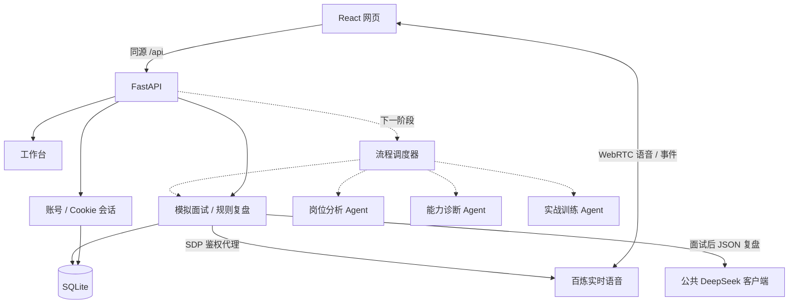

# 架构与边界

实线表示已实现；虚线表示规划。文字练习使用固定规则，实时语音使用百炼，
结束后的模型复盘复用岗位分支的公共 DeepSeek 客户端。
语音链路已通过模拟协议测试，真实云服务和麦克风验收仍需在密钥配置后执行。

## 公共基础

- `create_app(settings)` 支持独立测试实例，配置使用 `OFFER_` 环境变量。
- SQLite 使用外键、WAL、参数绑定与编号迁移，每次操作独立连接。
- 注册使用 Argon2id 哈希；数据库只保存随机会话令牌的 SHA-256 摘要。
- HttpOnly、SameSite=Lax Cookie，服务端固定到期、登录轮换、退出立即撤销。
- 所有认证响应禁止缓存；校验 Origin，退出另需会话 CSRF token。
- `/auth/me` 恢复当前用户和 CSRF token；前端只在内存中保留这些数据。
- 注册与登录共享每 IP 每分钟 10 次进程内限流，单进程开发版。
- 生产配置强制 Secure Cookie 和 HTTPS 来源。当前不信任 X-Forwarded-For。

## 后续扩展

既有独立练习记录继续读取。本次不追加编号迁移；公共表经 A 正式迁移建好后，
关联岗位的面试使用 `interview_sessions/interview_turns`，详细兼容边界见 `interview-integration.md`。
写操作复用 Origin 和 CSRF 校验，读写查询均包含登录用户 ID。
复盘复用 `AgentRequest` / `AgentResult`，待训练项保存在 `report.data.training_items`。
共享能力档案和调度器尚未完成，因此当前不回写公共档案。联调约定见 `interview.md`。

每个 Agent 拥有独立任务说明、工具权限和结构化输出，共享用户能力档案与证据引用。
调度器负责调用顺序、状态持久化、超时、预算、有限重试，先采用明确工作流。
工具结果必须可核验；模型判断不代表真实录用概率。
用户档案与任务记录按登录身份隔离；新增接口需同时提交越权测试。

注册当前未实现邮件所有权验证或找回密码，不把邮箱标记为已验证。
公开部署前应完成邮件服务、密码重置、共享限流、备份及隐私告知。
代码练习执行服务尚未实现，未来需独立受限运行环境，不直接在 API 主机执行用户代码。
