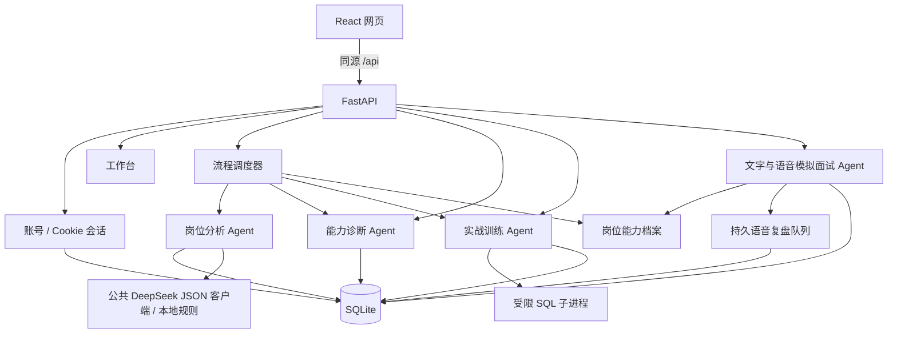

# 架构与边界

求职路线调度前三个步骤，在提交训练答案和参加面试时等待用户。工作台也提供四个独立入口。

## 公共基础

- `create_app(settings)` 支持独立测试实例，配置使用 `OFFER_` 环境变量。
- SQLite 使用外键、WAL、参数绑定与编号迁移，每次操作独立连接。
- 注册使用 Argon2id 哈希；数据库只保存随机会话令牌的 SHA-256 摘要。
- HttpOnly、SameSite=Lax Cookie，服务端固定到期、登录轮换、退出立即撤销。
- 所有认证响应禁止缓存；校验 Origin，退出另需会话 CSRF token。
- `/auth/me` 恢复当前用户和 CSRF token；前端只在内存中保留这些数据。
- 注册与登录共享每 IP 每分钟 10 次进程内限流，单进程开发版。
- 生产配置强制 Secure Cookie 和 HTTPS 来源。当前不信任 X-Forwarded-For。

## 调度和恢复

每个 Agent 拥有独立任务说明、工具权限和结构化输出，共享用户能力档案与证据引用。
调度器负责调用顺序、状态持久化、超时、预算、有限重试，先采用明确工作流。
工具结果必须可核验；模型判断不代表真实录用概率。
用户档案与任务记录按登录身份隔离；新增接口需同时提交越权测试。

岗位分析现已接入。结果按用户保存在 job_analysis_tasks；迁移 v2 追加表，不修改 v1。
规则和 DeepSeek 都输出统一要求结构，引用逐字核验并定位；固定工作流处理
材料接收、提取、证据核对及状态保存。路线复用相同岗位分析，再调用诊断和训练。
当前单进程开发部署在启动时将残留 running 任务标记为中断失败，不自动重放付费请求。
语音复盘队列保存未开始的任务，按租约限制同一数据库上的并行复盘。
多实例部署需共享会话、限流与任务执行设施。

面试模块包含独立三轮文字练习和实时可打断语音，两者使用独立会话。
语音通过 WebRTC 双向通信、流式转写与后端供应商适配；结束后冻结转写，再生成异步复盘。
关联模式复用岗位/诊断并保存公共面试表，独立练习保留兼容存储。见 [面试说明](interview.md)。
SQL 校验使用受限子进程与临时内存数据，不对应用数据库执行用户查询。

注册当前未实现邮件所有权验证或找回密码，不把邮箱标记为已验证。
公开部署前应完成邮件服务、密码重置、共享限流、备份及隐私告知。
首期仅执行受限 SQL 查询，不支持 Python 或任意程序执行；公网部署前仍需独立运行隔离和共享限流。
