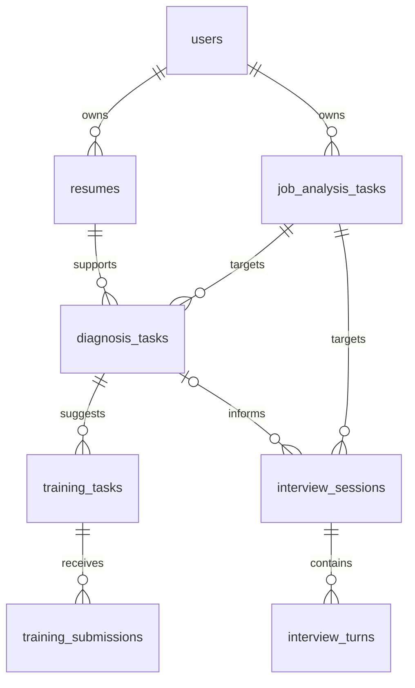

# 四人共用数据库约定

本约定用于 A/B/C/D 并行开发。共享表结构、迁移代码和模拟数据规范；
每个人运行自己电脑上的 SQLite 数据库，不共享或提交 `.db` 文件。

## 目前已存在什么

运行时正式迁移位于 `backend/app/core/database.py`：v1 账号与会话、v2 岗位分析、
v3 简历与诊断、v4 训练和面试公共表、v5 求职路线和复盘练习、v6 语音复盘队列。
v4 同时保留独立文字和语音练习的兼容表。
升级会识别已有岗位、诊断和 D 的实验面试布局，保留原记录；未知或不完整布局会停止并报错。

[建表参考](database-schema.sql) 用于评审和隔离测试，**不会被应用自动加载**。
它保留了设计中的 JSON CHECK 等约束；实际已应用迁移的细节以运行时代码为准。
不要向已有数据库手动执行该 SQL，不修改 user_version 或通过删库解决冲突。

## 统一字段规则

| 内容 | 约定 |
| --- | --- |
| 主键 | `id TEXT`，应用生成 UUID；沿用现有账号 ID |
| 所属用户 | `user_id TEXT NOT NULL`，来自后端登录身份，关联 `users.id` |
| 关联记录 | 使用 `job_analysis_id`、`resume_id`、`diagnosis_id` 等显式 ID |
| 时间 | `created_at` / 需要时的 `updated_at`，INTEGER，UTC 秒级时间戳 |
| 复杂内容 | SQLite TEXT 保存合法 JSON，写入和读取时用业务 Pydantic 模型校验 |
| 命名 | 表和字段使用 snake_case；不在每个模块中重复创建 users/sessions |
| 原文依据 | 保留来源记录 ID、逐字引用和可用的定位信息；不只保存模型总结 |
| 记录版本 | 新简历版本、重新分析或重新提交创建新记录，保留旧结果的关联依据 |

JSON 中以 `schema_version: 1` 标识新业务结果的版本，后续升级保持旧版可读。
已有岗位分析 payload 没有该字段时按初始版本读取，本规范不要求重写旧数据。
状态字段按下表各自的生命周期枚举校验，不将“训练题已生成”误当成“用户已完成训练”。

## 表与负责人

| 表 | 负责人 | 用途与主要字段 |
| --- | --- | --- |
| users | 公共 / A | 已实现：id、email、display_name、password_hash、created_at |
| sessions | 公共 / A | 已实现：token_hash、user_id、csrf_token、expires_at |
| job_analysis_tasks | A | PR #5：id、user_id、title、source_text、provider、status、payload、created_at |
| resumes | B | 简历版本：id、user_id、title、source_text、parsed_payload、created_at |
| diagnosis_tasks | B | 诊断：id、user_id、job_analysis_id、resume_id、status、result_payload、created_at、updated_at |
| training_tasks | C | 训练任务：id、user_id、diagnosis_id、title、goal、status、task_payload、created_at、updated_at |
| training_submissions | C | 每次提交：id、user_id、training_task_id、attempt_no、answer_text、status、evaluation_payload、created_at |
| interview_sessions | D | 面试：id、user_id、job_analysis_id、diagnosis_id（可空）、input_mode、status、max_rounds、report_payload、created_at、updated_at |
| interview_turns | D | 每轮问答：id、user_id、session_id、round_no、question_text、answer_text、input_mode、status、audio_duration_ms、feedback_payload、created_at、updated_at |

### 状态枚举

- 岗位分析和能力诊断：`running / completed / needs_input / failed`。
- 训练任务：`planned / active / completed / archived`，表示用户的训练进度。
- 训练提交：`pending / passed / failed / error`；failed 是答案未通过，error 是检查服务失败。
- 面试会话：`created / active / completed / cancelled / failed`。
- 面试轮次：`asked / answered / skipped`；问题创建后可暂时没有回答。
- 文字/语音模式：`text / voice`。会话保存当前模式，每轮保存实际输入方式。

`AgentResult.status` 继续使用现有 `completed / needs_input / failed`，
它表示一次 Agent 执行的结果，不直接替代训练或面试业务的生命周期。

## 数据怎样串起来

- B：从当前用户已完成的岗位分析和简历版本创建诊断，保留要求 ID 与证据。
- C：通过 diagnosis_id 取得缺口，生成训练任务；每次回答新增 submission。
- D：从岗位和可选的诊断创建面试；一个会话中可以切换文字/语音，每轮独立保存。
- A：调度器传递这些记录 ID，不让不同 Agent 覆盖同一个大 JSON 档案。

## 文字与语音面试的存储

默认保存用户确认后的回答文字、输入模式、问题、反馈和必要的音频时长。
语音识别得到的草稿先让用户编辑确认，确认后再写入 answer_text 并触发下一轮。
原始录音仅用于本次转写，不放进 GitHub 或数据库 BLOB，完成后释放/清理临时文件。
首版单段录音最长 60 秒、上传上限 8 MB；服务端复核大小、类型和时长。
问题朗读不改变问答记录；播放失败也不应丢失文字问题。

## 所有权、约束与删除

每个业务表保留 user_id；API 查询始终同时约束记录 ID 和当前 user_id。
写操作复用 `require_csrf`；前端传来的 user_id 不作为身份依据。
创建子记录时校验所有父记录都属于同一用户，且父任务状态满足业务要求。
面试关联诊断时，还需验证该诊断的 job_analysis_id 与面试目标岗位一致。

参考 SQL 用 `(父记录 id, user_id)` 复合外键限制跨用户关联，
唯一索引 `(id, user_id)` 支持对应关系；每次连接必须开启 `PRAGMA foreign_keys = ON`。
如需要链接另一条可选记录，NULL 表示未关联；不能伪造一个用户有权访问的空 ID。
唯一约束阻止同一训练任务的重复 attempt_no 和同一面试会话的重复 round_no。
并发提交时使用事务与唯一约束，重复请求返回一致结果或明确冲突，不能产生重复轮次。
最大面试轮数、父任务已完成等跨记录规则仍需后端校验。

参考 SQL 对父记录删除采用级联删除，因此删除简历/岗位/诊断可能同时删除下游结果。
首版不开放任意删除入口；后续如提供删除，须向用户说明影响并确保相应访问控制。

## 迁移怎么分工

1. A 协调 `backend/app/core/database.py` 中的公共迁移队列和版本号。
2. 已应用的 v1/v2/v3 不重写；本次统一追加 v4。
3. 下次新增迁移从 v7 开始，由 A 确认编号。
4. 各成员在自己的 Issue 中注明新增表、字段、关联与兼容性；由 A 组织一个公共迁移 PR。
5. 公共迁移合并后，组员更新 main，应用启动时自动升级本地库，不需要重建账号。
6. 若已有本地实验表，不直接修改 user_version 跳过迁移；先备份本地库，再整理成正式迁移。

示例 SQL 用来评审字段，后续正式迁移必须覆盖旧账号/会话/岗位记录保留、
从 v1/v2 升级、重复启动、外键约束、跨用户引用和失败回滚等情况。

## 每个人现在可以做什么

- B：按 resumes / diagnosis_tasks 定义 Pydantic 模型，用模拟岗位结果开发解析和诊断。
- C：按 training_tasks / training_submissions 定义输入输出，用模拟诊断开发一类练习。
- D：按 interview_sessions / interview_turns 开发文字与语音交互和模拟会话。
- A：维护迁移队列、历史布局升级和共享协议，后续增量从 v7 开始。

共享的是结构和升级代码，测试账号、真实简历、用户对话、密钥和 `.db` 均不提交。
之后部署服务器时再配置统一的持久数据库，各人开发库不需要相互同步。
