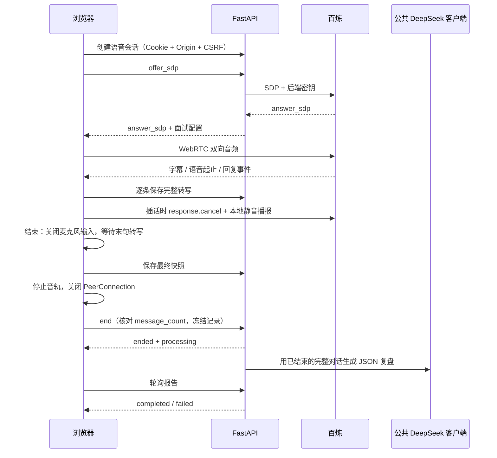

# 实时语音面试与结束后复盘

成员 D 的语音模块沿用 FastAPI + React，已与岗位、诊断和训练模块共用主应用。
语音使用阿里云百炼 Qwen-Omni-Realtime 原生双向音频，
面试后复盘复用团队 `core/model_client.py` 的 DeepSeek 客户端。
按本次确认保留实时可打断交互，不改成录音转写后逐句编辑确认。

## 当前验证状态

已实现 API、WebRTC 控制、转写持久化、自动/手动打断和结束后的异步复盘。
自动化测试使用模拟云服务与模拟 WebRTC，验证调用顺序、末句保存、失败和安全边界。
**尚未使用真实 API Key 做麦克风、中文识别、音色及插话延迟验收。**
配置完成后需按下文手动验收，不承诺未经测量的延迟或识别质量。

## 申请与配置（北京地域示例）

1. 在[阿里云百炼](https://bailian.console.aliyun.com/)开通模型服务，
   获取北京地域的 API Key 和业务空间 ID，并确认实时模型有调用权限及可用额度。
   另准备团队公共 DeepSeek Key，用于面试结束后的复盘。
2. 按根目录 README 安装锁定依赖，复制 `.env.example` 为 `.env`（已有文件时直接编辑）。
3. 在后端 `.env` 设置：

```dotenv
OFFER_VOICE_API_KEY=填入你的密钥
OFFER_VOICE_WEBRTC_URL=https://你的业务空间ID.cn-beijing.maas.aliyuncs.com/api/v1/webrtc/realtime
OFFER_VOICE_MODEL=qwen3.8-omni-flash-realtime
OFFER_VOICE_NAME=Tina
DEEPSEEK_API_KEY=填入团队使用的DeepSeek密钥
OFFER_DEEPSEEK_MODEL=deepseek-flash
OFFER_MODEL_TIMEOUT_SECONDS=12
OFFER_MODEL_MAX_ATTEMPTS=2
OFFER_MODEL_MAX_OUTPUT_TOKENS=1800
OFFER_MODEL_OUTPUT_BUDGET=3600
OFFER_VOICE_MAX_MINUTES=15
```

其他地域应同时修改语音地址、Key 与可用模型，不混用不同地域配置。
模型名和权限以控制台及[官方实时文档](https://help.aliyun.com/zh/model-studio/realtime)为准。
`/config` 的 `configured=true` 只表示已填写 Key 和 URL，不表示已通过云端连通性测试。

`.env` 不入库，不将 Key 写入前端 `VITE_` 配置。语音 Key 用于 SDP 鉴权，
`DEEPSEEK_API_KEY` 只用于结束后的内容复盘，两个服务分开检测配置。
原 `OFFER_VOICE_REVIEW_URL/MODEL` 已停用，请移除旧配置，统一使用公共 DeepSeek 设置。
公共客户端沿用岗位分支的超时、有限重试、JSON 校验与用量预算，引用校验在同一重试边界内执行。
`httpx` 已从开发依赖移为运行依赖，现有锁文件已包含同版本，无新增包版本。

重启后端，打开工作台 → 进入模拟面试 → 实时语音。
使用 HTTPS 或 `http://127.0.0.1`，允许麦克风，建议戴耳机。

## 数据流与状态



通话状态：`created → connecting → live → ended`。
分析状态：`not_started → processing → completed/failed`。
面试中不启动评分请求、不显示分数；结束操作可安全重试。

浏览器等到 `session.updated` 后才打开麦克风输入。
云端 VAD 检测到用户说话后，本地立即静音 AI 播报并取消正在生成的回复；
下一次 AI 回复开始时恢复播放，也提供“打断面试官”按钮。
被取消的面试官转写保留 `interrupted=true`，可能包含尚未听到的生成内容。

结束时关闭麦克风输入但保留通道，以静音让 VAD 提交末句；
等待语音结束、未完成 ASR 消息归零和静默窗口，最长等待约 12 秒。
未完成或失败的转写不会被当成完整回答：页面提示重试等待，
或由用户明确选择“仅用已保存内容结束”，报告标记不完整。
结束后按完整候选人回答生成报告；缺少完整回答则不生成评分。

## 给队友的字段约定

| 字段 | 类型 | 归属与用途 |
| --- | --- | --- |
| `role` | string | 独立练习手动填写；关联岗位时由后端采用 A 的岗位标题 |
| `experience` | string | 用户填写的模拟经历 |
| `job_analysis_id` | string / null | 关联已完成且属于当前用户的岗位分析 |
| `diagnosis_id` | string / null | 可选；必须属于相同用户和同一岗位，且诊断已完成 |
| `id` | string | 服务端生成的语音面试 ID，对应公共 `AgentResult.task_id` |
| `messages[].id` | string | 云端消息项 ID；保存、重试和证据引用的去重键 |
| `messages[].sequence` | integer | 对话中首次出现的顺序，0–200；不按 ASR 完成先后排列 |
| `messages[].role` | user / assistant | 区分回答与提问 |
| `messages[].text` | string | 转写内容；`final` 表示是否完成 |
| `messages[].interrupted` | boolean | 该段 AI 回复被打断，不等于用户听完全部文字 |
| `report.data.training_items` | array | 低于 4/5 分维度的待训练建议，供 C 后续消费 |
| `report.evidence[].source` | string | `voice:{面试ID}:message:{消息ID}` |

模块内函数名无需与队友一致；API 路径、方法、字段名和类型应按上述协议联调。
客户端不传 `user_id`，后端通过公共登录态确定归属。
通过 `/api/v1/interviews/contexts` 选择岗位和诊断；后端读取其记录并形成 `parent_context` 快照，
客户端不能伪造这个快照。岗位要求采用 A 的 `requirements`，诊断结果采用 B 的 `result_payload`。
统一 v4 迁移已建立公共面试表，关联功能开放，独立练习仍可使用。

复盘使用公共 `AgentResult`。`data.evaluation_mode=model-transcript-v1`，
固定四项：岗位理解、技术与经历、表达结构、反思改进，各 0–5 分，总分 20。
每个非零评分必须带候选人原文引用；服务端校验消息 ID、角色、完整状态和连续原文，
不合格输出作为生成失败，保留转写供重试，不静默改成无依据评分。
本版仅评价文字内容，不分析语速、口音、音色或真实录用概率。
关联面试的待训练项在保存复盘时生成面试后练习，可以在同一求职路线的能力档案里提交回答。

## 持久化、失败与部署边界

- 既有实验数据保留；统一 v4 迁移建立公共表后，关联会话使用
  `interview_sessions/interview_turns`，无关联的旧练习继续读取原记录，见[数据库适配说明](interview-integration.md)。
- 全部 API 按用户归属查询；写操作校验 Origin、CSRF。SDP/模型鉴权只在后端完成。
- 语音数据经 WebRTC 直接传给供应商；应用只保存浏览器上传的转写，不保存原始录音。
  转写是浏览器提交的数据，不是供应商签名或独立能力验证，不应当作可信招聘评测证书。
- 单会话不支持重复建连；刷新或断线可查看已保存转写、结束并复盘，再新建一场语音面试。
  不将这个流程称为无缝续接旧的云端对话。
- 完整转写逐条保存；关闭页面前尚未完成的识别片段可能丢失，正式结束会等待并检查末句。
- 后台复盘复用公共客户端默认 12 秒总时限、最多 2 次尝试和输出预算；后台外层另有 70 秒保护。
  SQLite 队列在结束面试时保存任务，尚未开始的任务可在重启后继续。运行中的任务租约为 90 秒。
  租约到期后可手动重试，每场最多运行三次。`report_usage` 保存各次已报告用量的累计值。
- 浏览器执行单场时长限制，并在退出、结束、组件卸载时关闭音轨和连接。
  该限制不是供应商侧强制费用上限；WebRTC 直连不支持由本后端强制撤销已建立的媒体连接。
  云端额度/并发限制需在供应商控制台配置。
- 语音创建、连接和复盘重试另有每用户每分钟 10 次进程内限流。

## 验收

自动化：根目录运行后端测试和 ruff，前端构建及 Playwright。
模拟 WebRTC 的桌面/手机测试检查打断、末句延迟到达、错误确认和结束后才调用复盘。

真实凭据配置后手动检查：

1. 允许麦克风，确认面试官问候、语音播放和中文转写；声音被浏览器拦截时点击播放按钮。
2. 在 AI 说话期间插话，确认旧播报停止、用户回答被识别，之后 AI 根据回答继续追问。
3. 切换静音，确认不会继续采集回答；恢复后继续对话。
4. 在最后一句说完后立即结束，确认转写保存后才生成报告，且引用与回答原文一致。
5. 模拟断网和转写失败，确认显示失败、不伪造完整回答，并可查看已保存内容。
6. 检查 Network 与构建产物没有 API Key；检查数据库未保存音频。
7. 检查真实模型耗时、识别效果及供应商账单，记录测量结果后再声明联调完成。

## 参考来源

借鉴设计，当前实现未复制第三方实现代码：

- [interview-agent-py](https://github.com/renjianguojinqianfan/interview-agent-py)：
  FastAPI/React、通话和评估分离（AGPL-3.0）。
- [DeepInterview](https://github.com/ngoanpv/DeepInterview)：prep/live/post 分层（Apache-2.0）。
- [realtime-interview-practice](https://github.com/Jaskey15/realtime-interview-practice)：
  WebRTC 对话与面试后复盘（MIT）。
- [百炼实时语音协议](https://help.aliyun.com/zh/model-studio/realtime)、
  [客户端事件](https://help.aliyun.com/zh/model-studio/client-events)、
  [结构化输出](https://help.aliyun.com/zh/model-studio/qwen-structured-output)。
